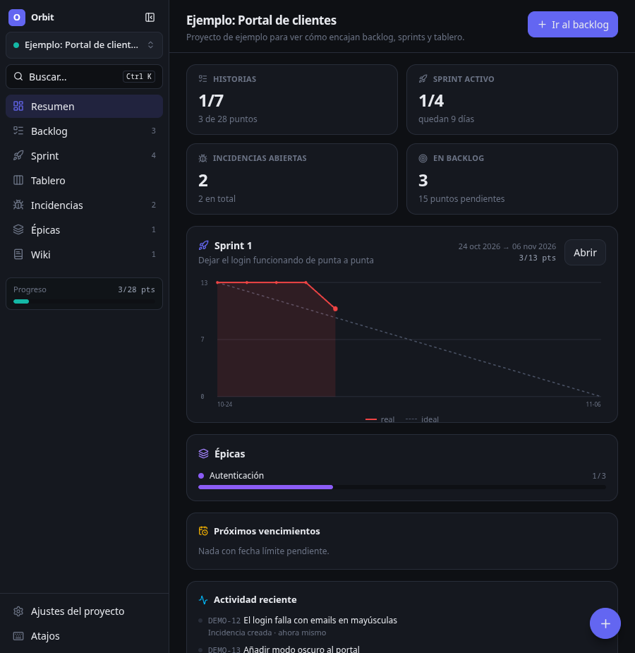

# Orbit

Gestor de proyectos personales de escritorio, al estilo de Taiga: backlog, sprints
con burndown, tablero kanban, incidencias, épicas y wiki. Todo en local, en una
base SQLite tuya, sin cuentas ni servidor.



## Qué trae

| Zona | Qué puedes hacer |
| --- | --- |
| **Resumen** | Métricas del proyecto, burndown del sprint activo, vencimientos, items bloqueados y actividad reciente. |
| **Backlog** | Lista ordenable de historias y panel de sprints. Arrastra historias al sprint, estima con la escala Fibonacci, filtra por texto, épica o etiqueta. |
| **Sprint** | Taskboard de verdad: filas por historia, columnas por estado de tarea, arrastre entre celdas, burndown y cierre de sprint. |
| **Tablero** | Kanban de historias por estado, con límites WIP, puntos por columna y alta rápida en cada columna. |
| **Incidencias** | Bugs, mejoras, dudas y mantenimiento con tipo, severidad y prioridad. Vista de tabla o de tablero. |
| **Épicas** | Agrupan historias y muestran su progreso en puntos. |
| **Wiki** | Páginas en Markdown por proyecto (tablas, listas de tareas, código). |
| **Ajustes** | Columnas a medida por tipo de item, cuáles cuentan como cerrado, límites WIP, colores de etiquetas, exportar/importar. |

Además: paleta de comandos y búsqueda global con `Ctrl+K`, notas en cualquier
item, referencias tipo `DEMO-12`, archivado de proyectos y modo oscuro.

## Arrancar

```bash
npm install
npm run electron:fetch   # sólo si npm bloqueó la descarga del binario de Electron
npm run dev
```

Para usarla a diario conviene empaquetarla:

```bash
npm run dist        # AppImage + .deb en release/
```

O, sin empaquetar, `npm run build && npm start`.

## Dónde viven los datos

Una única base SQLite en el directorio de datos de la aplicación
(`~/.config/orbit/orbit.db` en Linux). La ruta exacta está en
**Ajustes del proyecto → Datos**, junto a los botones de exportar e importar JSON.
Para copia de seguridad basta con guardar ese fichero o exportar el JSON.

## Atajos

| Tecla | Acción |
| --- | --- |
| `Ctrl+K` | Buscar / paleta de comandos |
| `Ctrl+N` | Nueva historia |
| `Ctrl+Shift+N` | Nuevo proyecto |
| `Ctrl+1…7` | Cambiar de vista |
| `Ctrl+B` | Mostrar u ocultar el panel lateral |
| `?` | Ver todos los atajos |

## Estructura

```
src/
  shared/types.ts    modelo de dominio compartido
  main/
    db.ts            esquema SQLite y apertura de la base
    api.ts           todas las operaciones de dominio
    index.ts         ventana, menú nativo, IPC, exportar/importar
    devtools.ts      capturas automáticas (sólo con ORBIT_DEV_CAPTURE)
  preload/index.ts   puente contextIsolation -> window.orbit
  renderer/src/
    store/           estado global (zustand)
    components/      primitivas, tablero DnD, diálogo de item, paleta
    views/           una por pestaña
tests/smoke.mjs      test de la capa de datos
```

El renderer nunca toca la base: llama a `window.orbit.call('story.update', …)`,
que el proceso principal resuelve contra el mapa de métodos de `src/main/api.ts`.

## Comandos

```bash
npm run dev          # desarrollo con recarga en caliente
npm run build        # compila a out/
npm start            # ejecuta lo compilado
npm test             # compila y pasa el test de humo de la capa de datos
npm run typecheck    # TypeScript en main, preload y renderer
npm run icon         # regenera build/icon.png
npm run dist         # empaqueta AppImage y .deb
```

## Decisiones técnicas

- **Electron 45 + `node:sqlite`.** SQLite viene dentro del runtime de Electron, así
  que no hay módulos nativos que recompilar en cada actualización.
- **Snapshot por proyecto.** Cada mutación recarga el proyecto entero desde la base.
  Con volúmenes personales cuesta menos de un milisegundo y elimina toda una clase
  de bugs de estado desincronizado.
- **Orden global único.** Historias, tareas e incidencias comparten un campo
  `position` por proyecto, de modo que reordenar en el tablero respeta el orden del
  backlog y al revés.
# Orbit
