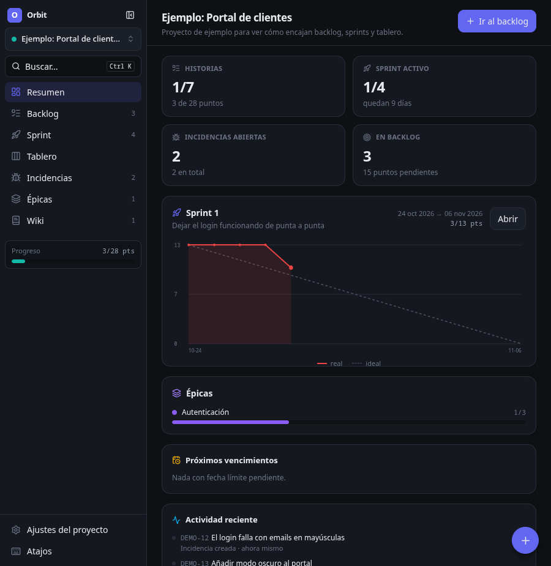

# Orbit

Gestor de proyectos personales de escritorio, al estilo de Taiga: backlog, sprints
con burndown, tablero kanban, incidencias, épicas y wiki. Los datos viven en una
base SQLite tuya, en tu equipo, y la aplicación funciona entera sin red.

Si le das un servidor propio, varios equipos se sincronizan contra él: cada uno
sigue trabajando con su base local y los cambios se reconcilian cuando hay red.
Sin servidor configurado, Orbit es exactamente lo que era, en local y sin cuentas.



## Qué trae

| Zona | Qué puedes hacer |
| --- | --- |
| **Hoy** | Dos pendientes de vida y la tarea en curso. Al terminar una, aparece la siguiente. |
| **Pendientes** | La lista entera de cosas de la vida: añadir, marcar hecho, borrar. |
| **Resumen** | Métricas del proyecto, burndown del sprint activo, vencimientos, items bloqueados y actividad reciente. |
| **Backlog** | Lista ordenable de historias y panel de sprints. Arrastra historias al sprint, estima con la escala Fibonacci, filtra por texto, épica o etiqueta. |
| **Sprint** | Taskboard de verdad: filas por historia, columnas por estado de tarea, arrastre entre celdas, burndown y cierre de sprint. |
| **Tablero** | Kanban de historias por estado, con límites WIP, puntos por columna y alta rápida en cada columna. |
| **Incidencias** | Bugs, mejoras, dudas y mantenimiento con tipo, severidad y prioridad. Vista de tabla o de tablero. |
| **Épicas** | Agrupan historias y muestran su progreso en puntos. |
| **Wiki** | Páginas en Markdown por proyecto (tablas, listas de tareas, código). |
| **Ajustes** | Columnas a medida por tipo de item, cuáles cuentan como cerrado, límites WIP, colores de etiquetas, exportar/importar. |

Además: paleta de comandos y búsqueda global con `Ctrl+K`, notas en cualquier
item, referencias tipo `DEMO-12`, archivado de proyectos y modo oscuro.

## Arrancar

```bash
npm install
npm run electron:fetch   # sólo si npm bloqueó la descarga del binario de Electron
npm run dev
```

Para usarla a diario conviene empaquetarla:

```bash
npm run dist        # AppImage + .deb en release/
```

O, sin empaquetar, `npm run build && npm start`.

## Dónde viven los datos

Una única base SQLite en el directorio de datos de la aplicación
(`~/.config/orbit/orbit.db` en Linux). La ruta exacta está en
**Ajustes del proyecto → Datos**, junto a los botones de exportar e importar JSON.
Para copia de seguridad basta con guardar ese fichero o exportar el JSON.

## Atajos

| Tecla | Acción |
| --- | --- |
| `Ctrl+K` | Buscar / paleta de comandos |
| `Ctrl+N` | Nueva historia |
| `Ctrl+Shift+N` | Nuevo proyecto |
| `Ctrl+H` | Ir a Hoy |
| `Ctrl+P` | Ir a Pendientes |
| `Ctrl+1…7` | Cambiar de vista del proyecto |
| `Ctrl+B` | Mostrar u ocultar el panel lateral |
| `?` | Ver todos los atajos |

## Estructura

```
src/
  shared/
    types.ts           modelo de dominio compartido
    sync.ts            formas que cruzan la frontera main <-> renderer
  core/                Node pelado: nada de aquí sabe que existe Electron
    db.ts              esquema SQLite y apertura de la base
    replication.ts     diario de cambios para sincronizar
    sync.ts            aplica los cambios que llegan de otro equipo
    client.ts          empuja y tira contra el servidor
    modules/
      orbit.ts         las operaciones de dominio de Orbit
      pendientes.ts    la lista de cosas de la vida
      hoy.ts           consulta derivada: nada propio, solo lee
      registry.ts      el mapa de métodos de todos los módulos
  server/              el concentrador del VPS, también Node pelado
    index.ts           HTTP: /api/login y /api/sync
    auth.ts            usuario único, tokens y freno de intentos
    hub.ts             diario del servidor y protocolo de sincronización
  main/
    index.ts           ventana, menú nativo, IPC, exportar/importar
    sync.ts            la cuenta, el token y el ciclo de sincronización
    devtools.ts        capturas automáticas (sólo con ORBIT_DEV_CAPTURE)
  preload/index.ts     puente contextIsolation -> window.orbit
  renderer/src/
    store/             estado global (zustand)
    components/        primitivas, tablero DnD, diálogo de item, paleta
    views/             una por pestaña, más Hoy y Pendientes
tests/
  boundaries.mjs       que las capas no se mezclen
  smoke.mjs            la capa de datos
  replication.mjs      el diario de cambios
  sync.mjs             conflictos entre dos equipos
  desktop-sync.mjs     la cuenta y el token en el llavero del sistema
  pendientes.mjs       el módulo de pendientes
  hoy.mjs              la vista Hoy por el lado de los datos
  server.mjs           el servidor de punta a punta
  client.mjs           dos equipos sincronizando contra un servidor real
```

El renderer nunca toca la base: llama a `window.orbit.call('story.update', …)`,
que el proceso principal resuelve contra el mapa de métodos de
`src/core/modules/registry.ts`.

`src/core` se mantiene libre de Electron a propósito, para que el mismo código
de dominio corra igual en la aplicación y en el servidor. `tests/boundaries.mjs`
lo comprueba, y `tests/server.mjs` lo demuestra arrancando el servidor con
`node` a secas.

## Módulos

La aplicación se divide en módulos de primer nivel que no se mezclan entre sí:

| Módulo | Qué es |
| --- | --- |
| **Hoy** (`Ctrl+H`) | Por dónde empezar: dos pendientes y la tarea en curso |
| **Proyectos** (`Ctrl+1`) | Todo lo de Taiga: backlog, sprints, tablero, incidencias, épicas y wiki |
| **Pendientes** (`Ctrl+P`) | La lista de cosas de la vida, que no cuelgan de ningún proyecto |

El selector de proyecto y sus siete vistas solo existen dentro de **Proyectos**;
desde Hoy o Pendientes no estorban. Los pendientes se añaden desde la propia
aplicación o desde el atajo del móvil: es la misma lista.

## Hoy

La pantalla con la que se empieza el día: **dos** pendientes de vida y **una**
tarea del trabajo. Al marcar algo hecho aparece lo siguiente, y no hay nada más
que mirar.

"La tarea en curso" es la tarea no cerrada del sprint abierto con la posición
más baja, de cualquier proyecto no archivado. Como `position` va por proyecto,
entre varios proyectos con sprint abierto el empate lo rompe la fecha de
creación. Marcarla hecha la pasa a la primera columna de cierre de su proyecto;
si el proyecto no tiene ninguna, la pantalla lo dice en vez de callarse.

El módulo `hoy` no tiene tablas ni escribe nada: es una consulta derivada sobre
lo que ya hay.

## Servidor

En el VPS se despliega con Docker (más abajo). Para levantarlo a mano, en
desarrollo:

```bash
ORBIT_PASSWORD=… ORBIT_DATA=./datos ORBIT_PORT=8787 npm run server
```

| Variable | Para qué | Por defecto |
| --- | --- | --- |
| `ORBIT_PASSWORD` | Siembra la contraseña la primera vez. No hay registro abierto | obligatoria al principio |
| `ORBIT_DATA` | Carpeta de `orbit.db` | `/datos` |
| `ORBIT_PORT` | Puerto | `8787` |

| Ruta | Quién | Para qué |
| --- | --- | --- |
| `GET /api/health` | nadie | decir que está en pie, para Docker |
| `POST /api/login` | contraseña | devuelve un token de equipo |
| `POST /api/sync` | token de equipo | empujar y tirar cambios |
| `POST /api/tokens` | token de equipo | emitir el token del móvil |
| `POST /api/pendientes` | token de equipo o de móvil | añadir un pendiente |

El token va en `Authorization: Bearer …`. Las tablas de usuario y de tokens
viven solo aquí y no se replican nunca.

Un token de equipo solo sale del login con contraseña: el del móvil no puede
emitir otros ni sincronizar, así que si se filtra, lo único que se consigue con
él es añadirte pendientes.

### El atajo del móvil

Con un token de equipo se emite el del móvil, una sola vez:

```bash
curl -X POST https://orbit.midominio.dev/api/tokens -H "authorization: Bearer $TOKEN_EQUIPO" -H "content-type: application/json" -d '{"scope":"pendientes","name":"movil"}'
```

Y el atajo hace una sola petición:

```bash
curl -X POST https://orbit.midominio.dev/api/pendientes -H "authorization: Bearer $TOKEN_MOVIL" -H "content-type: application/json" -d '{"texto":"Comprar pan"}'
```

Lo que escribe el móvil queda en el diario del servidor y baja a los equipos en
la siguiente sincronización.

### Desde la aplicación

La aplicación escribe siempre en su base local, así que va igual de rápida con
red que sin ella. Aparte, cada minuto —y al volver a la ventana— empuja lo que
tenga pendiente y se trae lo que haya. Si trajo algo, la vista se recarga sola.

Los conflictos se resuelven por último-gana sobre cada fila, con dos matices:
un reordenamiento gana o pierde entero, y un borrado no revive salvo que la
edición sea posterior.

Se configura en **Ajustes → Servidor**: dirección y contraseña. La contraseña
se cambia por un token y no se guarda en ninguna parte; el token va al llavero
del sistema, y si el sistema no tiene llavero la pantalla lo avisa, porque
entonces queda en claro en la base local. Desde ahí también se sincroniza a
mano y se desconecta el equipo.

## Despliegue

El servidor va en un contenedor que no lleva nada más que el bundle: no tiene ni
una dependencia de npm, solo módulos de Node.

```bash
cp .env.example .env     # y pon dentro una ORBIT_PASSWORD larga
docker compose up -d --build
```

`ORBIT_PASSWORD` **solo siembra la contraseña la primera vez**. Después se
ignora; para cambiarla hay que borrar la fila de `app_user` de la base.

El contenedor escucha en `127.0.0.1:8787`, no en todas las interfaces: el que
habla con internet es nginx, no esto.

```nginx
location / {
  proxy_pass http://127.0.0.1:8787;
  proxy_set_header Host $host;
  proxy_set_header X-Forwarded-For $proxy_add_x_forwarded_for;
}
```

Detrás de un proxy, el freno de intentos de login ve siempre la IP del proxy, o
sea que de hecho es global. Para un servidor de un solo usuario sale a favor.

### Copias de seguridad

La base vive en el volumen `orbit-datos`. Está en WAL, así que copiar
`orbit.db` en caliente no vale: se quedaría sin lo que haya en el `-wal`. Lo que
sí vale es que SQLite escriba una copia consistente él mismo.

```bash
docker compose exec orbit node -e "const { DatabaseSync } = require('node:sqlite'); new DatabaseSync('/datos/orbit.db').exec(\"VACUUM INTO '/tmp/copia.db'\")"
```

```bash
docker compose cp orbit:/tmp/copia.db ./orbit-$(date +%F).db
```

```bash
docker compose exec orbit rm /tmp/copia.db
```

El `rm` del final no es cosmético: `VACUUM INTO` se niega a escribir si el
fichero ya existe, así que sin borrarlo la copia solo funcionaría una vez.

Y siempre queda la salida de emergencia: **Ajustes → Datos → Exportar todo a
JSON**, desde cualquier equipo que esté sincronizado.

## Comandos

```bash
npm run dev          # desarrollo con recarga en caliente
npm run build        # compila la aplicación a out/
npm run build:server # compila el servidor a out/server/
npm start            # ejecuta lo compilado
npm test             # fronteras, compila, y los ocho tests de datos, servidor y sync
npm run typecheck    # TypeScript en core, server, main, preload y renderer
npm run icon         # regenera build/icon.png
npm run dist         # empaqueta AppImage y .deb
```

## Decisiones técnicas

- **Electron 45 + `node:sqlite`.** SQLite viene dentro del runtime de Electron, así
  que no hay módulos nativos que recompilar en cada actualización.
- **Snapshot por proyecto.** Cada mutación recarga el proyecto entero desde la base.
  Con volúmenes personales cuesta menos de un milisegundo y elimina toda una clase
  de bugs de estado desincronizado.
- **Orden global único.** Historias, tareas e incidencias comparten un campo
  `position` por proyecto, de modo que reordenar en el tablero respeta el orden del
  backlog y al revés.
# Orbit
